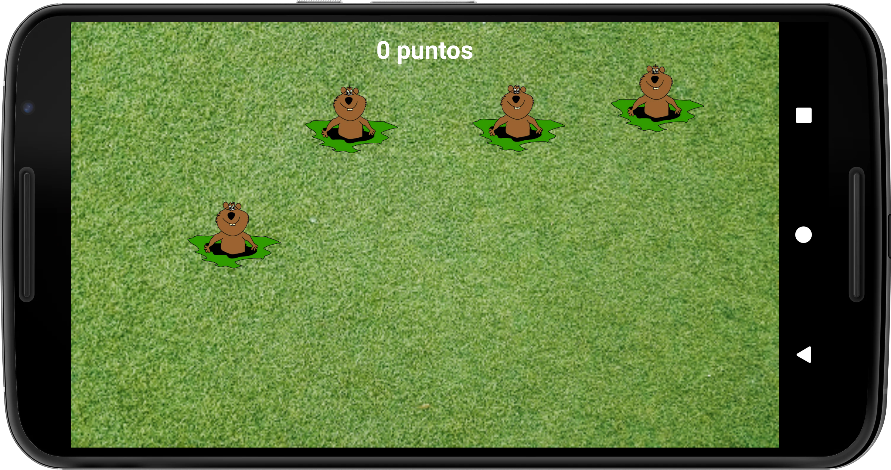
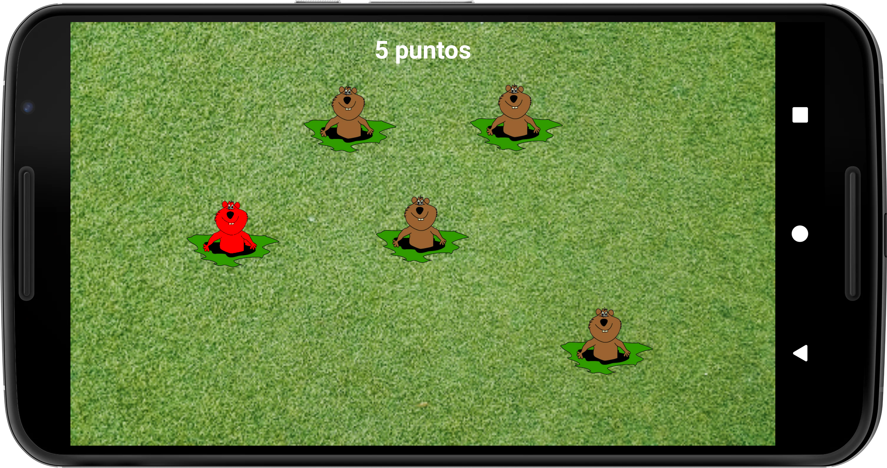
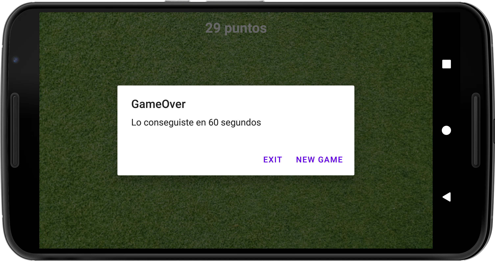

# 🔨 Mole Smash — Whack-a-Mole Game (Kotlin + Android)

An Android **whack-a-mole** game. Moles pop out of the grass at random and the player taps them before they hide. Brown moles give 1 point and the rare **red ones give 10**. Reach 20 points as fast as you can.

> 🎓 **Academic project.** Built for the **Multimedia Programming and Mobile Devices** module (*Programación Multimedia y Dispositivos Móviles, PMDM*) of the **Higher Vocational Degree in Multiplatform Application Development** (*CFGS Desarrollo de Aplicaciones Multiplataforma, DAM*), 2nd year.

---

## 📸 Screenshots

| Game | Red mole | Game over |
|---|---|---|
|  |  |  |

---

## ✨ Features

- **10 holes** in the grass. In every round **1 to 5 moles** come out in random holes.
- **Random hiding time**: each round the moles hide after 0.5, 1 or 1.5 seconds and a new round starts.
- **Two kinds of mole**:
  - 🟤 Brown mole → **+1 point**.
  - 🔴 Red mole (10% chance) → **+10 points**.
- **Frame animations** when a mole comes out and a different image when it is hit.
- **Sound effect** when a mole is hit.
- **Live score** on screen.
- **Victory at 20 points**: the dialog shows how many seconds it took and lets the player start a **New Game** or **Exit**.

---

## 🧰 Tech Stack

| Layer | Technology |
|---|---|
| Language | **Kotlin** |
| Platform | Android (minSdk 21, targetSdk 33) |
| UI | `ConstraintLayout`, `ImageView` |
| Animation | `AnimationDrawable` (frame animations) |
| Audio | `SoundPool` |
| Async | Kotlin Coroutines |
| IDE / build | Android Studio (Gradle) |

---

## 🏗️ Architecture

The whole game runs in a single `MainActivity`, which implements `View.OnClickListener`:

| Method | Responsibility |
|---|---|
| `newGame()` | Resets the score and the timer and starts the first round |
| `sacaTopos()` | Chooses how many moles come out and in which holes |
| `showTopos()` | Decides if each mole is brown or red (10% chance) and starts its animation |
| `tapaTopos()` | Hides the moles after a random time and starts the next round (coroutine) |
| `onClick()` | Adds the points, plays the sound and shows the hit image |
| `deathSound()` | Plays the hit sound and stops it after one second |
| `gameOver()` | Shows the victory dialog with the elapsed time |

### Implementation details

- **Random holes without repeats**: the numbers 0–9 are shuffled and the first *n* are taken, so a hole is never chosen twice in the same round.
- **Dynamic drawables**: the animations (`animacion_normal`, `animacion_especial`) and the hit images (`tdead`, `tedead`) are loaded at runtime with `resources.getIdentifier()`.
- **Type of mole in the `tag`**: each `ImageView` stores `"normal"` or `"especial"` in its `tag`, and `onClick()` uses it to decide the points and the hit image.
- **One listener for 10 holes**: the activity walks the children of the `ConstraintLayout` and assigns the same listener to every `ImageView`.
- **Non-blocking delay**: moles are hidden from a coroutine, which switches back to the main thread to update the UI.

---

## 📁 Project Structure

```
mole-smash-android/
├── app/src/main/
│   ├── java/net/azarquiel/juegotopos/
│   │   └── MainActivity.kt          # Game logic
│   ├── res/
│   │   ├── drawable/                # Mole frames, hit images, grass, animations
│   │   ├── layout/activity_main.xml # Grid of 10 holes + score
│   │   ├── raw/sonidomuerte.mp3     # Hit sound
│   │   └── values/                  # Strings, colors, themes
│   └── AndroidManifest.xml
├── screenshots/
└── build.gradle / settings.gradle
```

---

## 🚀 Running Locally

### Prerequisites
- Android Studio
- Android SDK 33
- An emulator or an Android device (Android 5.0+)

### Steps
1. Clone the repository:
   ```bash
   git clone https://github.com/ivangomezr/mole-smash-android.git
   ```
2. Open the project in Android Studio and let Gradle sync.
3. Press **Run ▶** and choose an emulator or a connected device.

---

## 🙋 Author

**Iván Gómez** — [@ivangomezr](https://github.com/ivangomezr)

Developed as coursework for the *Multimedia Programming and Mobile Devices* module, DAM.